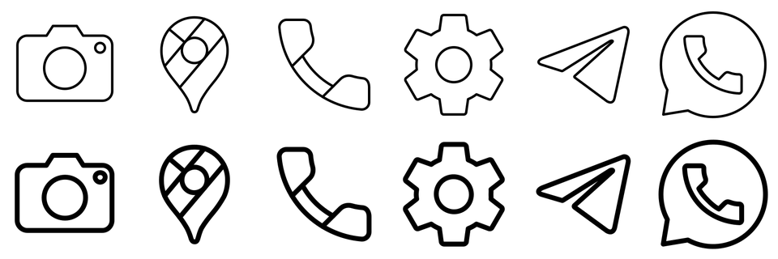

# Arcticons Bold

Arcticons Bold is [Arcticons](https://github.com/Arcticons-Team/Arcticons) Black redrawn with a line twice as thick. Stock Arcticons lines get faint on e-ink and other monochrome screens at launcher icon sizes; this pack keeps the same 15000+ icons and only changes the stroke.



All icons are made by the [Arcticons contributors](https://github.com/Arcticons-Team/Arcticons/graphs/contributors). This fork adds nothing but the renderer that thickens them. Missing icons have to be requested in Arcticons itself; they show up here after the next rebuild.

Works with any launcher that supports ADW or Nova icon packs. Installs next to the official Arcticons apps (package `io.github.andreygladkov.arcticonsbold`).

## How it is built

The `bold` flavor renders `icons/black/*.svg` into 256 px WebP icons with a stroke width of 2.0 (stock is 1 on a 48-unit viewBox). Explicit `stroke-width: 0` on filled shapes is kept. Rendering happens at build time in `:preparehelper:runbold`, so the repository stores no extra icon files.

Requirements: JDK 21 and the Android SDK.

```sh
gradle :app:assembleBoldRelease
```

The repository ships no Gradle wrapper, same as upstream; use Gradle 9.7 or newer. Another stroke width can be tried with `-PboldStrokeWidth=1.5`.

Release builds are signed with the key described in `keystore.properties` (not committed); without it they fall back to the debug key.

## Updating icons

```sh
git fetch upstream
git merge upstream/main
gradle :app:assembleBoldRelease
```

## License

Same as Arcticons: the code is under the [GPL-3.0 license](https://www.gnu.org/licenses/gpl-3.0.en.html), the icons are under [CC BY-SA 4.0](https://creativecommons.org/licenses/by-sa/4.0/). The thickened icons are a derivative of Arcticons and stay under CC BY-SA 4.0.
